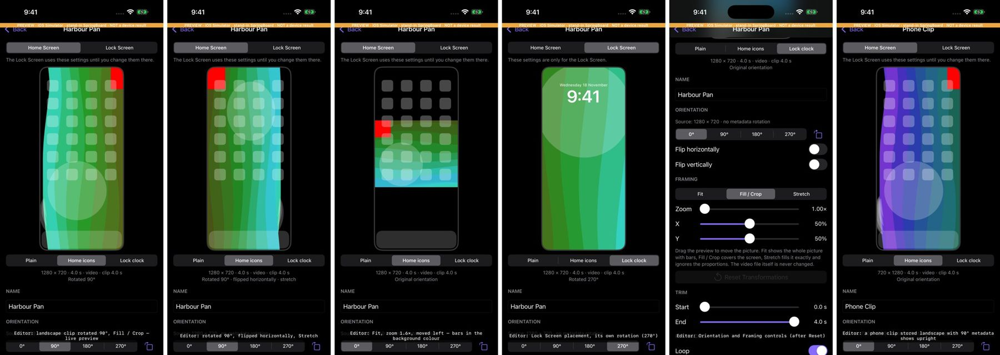

# Testing — what has and has not been verified

Build validation, Simulator evidence and device testing are reported **separately**. Only the last one says anything
about SpringBoard on a phone, and **it has not happened yet** (for either version).

# 0.2.0~alpha1 — orientation and transformation (development build)

## A. Build validation — PASSED

| Check | Where | Result |
|---|---|---|
| C core incl. transformed layout: 11 media sizes (portrait, landscape, square, 32:9, 1:512, 512:1, 8K…), 6 containers, rotations −90…450, flips, Fit / Fill / Crop / Stretch, regions; determinant, corners = frame, cover / inside, aspect kept, identity = 1.0 layout; zoom ↔ region round trips | `tests/test_core.c`, GCC + Clang (ASan/UBSan), Linux and macOS | **137,986 checks passed** |
| C core 1.0 unchanged (1.1 appended; stripped file = the SHA-256s HCG Animation Center for Mac vendors) | `tests/test_core_compat.py` | **pass** |
| Schema ↔ examples ↔ C constants; the **1.0 schema** (fixture, = Mac's vendored copy) still accepts every example including `Skyline-Rotated`; refusals of non-quarter rotations / non-boolean flips | `tests/test_schema.py` | **59 checks passed** |
| Canonical build, macOS 15 / Xcode | run [44885278113](https://github.com/F1r3srp3nt/HCG-Jailbreak-Research/actions/runs/44885278113), commit `4fbebd2` | **success** |
| `validate.sh --require-new-abi` (in CI) | same run | **0 failures, 0 warnings** |
| Independent re-check: artifact downloaded (zip digest = GitHub's), `.deb` SHA-256 recomputed, `validate.sh --require-new-abi` re-run from a clean worktree of `4fbebd2` | development container | **same SHA-256; 0 failures, 0 warnings**; build ID `4fbebd2e89ce`, native arm64e ABI `0x80000002`, no wallpaper-changing API |

Package: `com.hakmicapitalgroup.animationcenter_0.2.0~alpha1_iphoneos-arm64.deb`, 417,674 bytes, SHA-256
`d9bb375e78ee728a84ea93d7350562da309cc7b9ddef1c7b7dbae4f29f762e20` (provenance:
`distribution/dev-builds/0.2.0-alpha1/PROVENANCE.md`).

## B. iOS Simulator — runtime tests — PASSED (236 checks)

Job *simulator-tests* of run 44885278113. Generated media with a red marker in the stored frame's top-left corner.

| Case | Result |
|---|---|
| Portrait 360×640, landscape 640×360, square 480×480, ultrawide 1280×360, **rotated metadata 90° / 180° / 270°** (640×360 stored) | imported **without transcoding** (`.mov`, stored frame and orientation metadata unchanged); display size and `sourceRotation` detected correctly; still = displayed frame (size and marker corner correct) |
| 3840 × 1080 | stored as is (0.21 s import) |
| 3840 × 2160 with 90° metadata | converted once (4.47 s), upright, 1536 × 2730 (aspect kept, budget kept), marker where the metadata puts it |
| Renderer, 7 clips × 4 rotations × 4 flip combinations × Fit / Fill-Crop / Stretch × zoom 1 / 1.6 + moved | **672 layouts = the C core** (frame, bounds, matrix), still layer = video layer |
| Rendered pixels (Stretch, every rotation × flip, 7 clips) | **112 cases**: the marker is in the corner rotation + flips predict |
| Library thumbnail orientation (`HACOrientedImage`) | same corner as the renderer, sides swapped |
| Playback with a transform | looped at 1.5×, trim 0.3–1.3 s kept, video layer carries the matrix; rotation / stretch edits keep the same decoder; play-once still works |
| Placements | Home / Lock saved separately (each its own still); survive reload; `library.json` v2 entry still reads as a v1 preset (Home) without warnings; assignments follow each placement; shared name; *Use Home Screen Settings* deletes the Lock still; a 0.1 `library.json` loads |
| Export / import | Lock placement `.hcgbackground` carries its transform; `.hcgpack` manifest, `preset.json` = default placement, sizes listed; re-import restores both placements; damaged still and newer pack version refused; removing an item removes both stills |
| Compatibility | presets that never used a transform have no `transform` / `sourceRotation` keys; `Skyline-Rotated` example reads and round-trips |
| Performance | `hcgbg_layout_transformed` **0.76 µs**; layout-only edit on a playing 3840×1080 clip **0.29 ms** (2,000 edits, one decoder) |
| Memory (`phys_footprint`, Simulator) | playing 3840×1080: +1.0 MB upright; +10.1 MB after 2,000 rotation / flip / crop edits (bound 25 MB). Rotation itself allocates no decode buffers (same decoder, same item); the difference is within run-to-run noise of Core Animation transactions and was not investigated further |

## B2. iOS Simulator — preview with the real editor — PASSED (68 checks, 22 screenshots)

Workflow *HCG Animation Center preview*, run [44885527130](https://github.com/F1r3srp3nt/HCG-Jailbreak-Research/actions/runs/44885527130)
(commit `0ddd69e`: package sources = `4fbebd2`, plus preview-harness fixes). All 0.1 scenes still pass; new scenes
drive the real Settings editor on generated clips (red marker = the stored frame's top-left):

| Scene | Checked |
|---|---|
| 08 landscape clip, Rotate 90°, Fill / Crop | preview matrix is a clockwise quarter turn; covers the portrait screen; marker top-right |
| 09 + Flip horizontally, Stretch | fills the screen exactly; marker back top-left |
| 10 Fit, zoom 1.6×, moved left | stored as `layout.transform` + region; bars below |
| 11 Lock Screen placement, 270° | starts from the Home settings; gets its own; both saved (Home: Fit 0°, Lock: Fill / Crop 270°) |
| 12 Reset Transformations, controls | identity, Fill, no transform; Orientation / Framing controls shown |
| 13 phone clip stored landscape with 90° metadata | 720 × 1280 detected, not transcoded, upright with no editor rotation |

## C. HCG Animation Center for Mac readers — PASSED

The pack and preset exported by the iOS code in the Simulator (artifact `hcg-animationcenter-sim-exports`), checked with
the Mac project's own tools at `F1r3srp3nt/animation-centre@5382265` (read-only):

| Tool | Result |
|---|---|
| `scripts/validate_pack.py` (CI and again in the development container) | **OK**; notes: `home-screen` / `lock-screen` not known to version 1 readers (ignored) — expected |
| `hcgpack validate` / `info` (Swift reader, built in CI) | **OK: pack.json, preset.json and every checksum verified**; shows `app-background` (Fit, upright — the transform is ignored as documented) |
| Exported `.hcgbackground` (Lock placement: 270°, flip V, Stretch) vs the Mac's preset schema | **valid** |

## D. Battery — NOT MEASURED

Not measurable in the Simulator. By construction: the transform is one Core Animation affine transform on the layer
that already shows the video (no extra decoding, no offscreen pass, no re-encoding), so per-frame cost should equal
the untransformed clip's. Videos up to 4.19 MP now play at their own resolution where 0.1 downscaled above 2688 px —
for those clips decode cost is higher than in 0.1. Device rows O9 / O10 in `DEVICE_TEST_CHECKLIST.md`.

## E. Device testing — NOT DONE

---

# 0.1.0~beta1

## 1. Build validation (package and source) — PASSED

| Check | Where | Result |
|---|---|---|
| C core: layout, crop, preset sanitising, GIF timing, playback policy (exhaustive over all 49,152 input combinations) | `tests/test_core.c`; Linux GCC + Clang (ASan/UBSan), macOS | **49,243 checks passed** |
| Preset schema ↔ examples ↔ C constants | `tests/test_schema.py` | **28 checks passed** |
| Packaging-format regression (gzip-only members) | `tests/test_deb_format.py` | **13 cases, 0 failures** |
| Canonical build, macOS 15 / Xcode, Theos `8167f59`, patched iPhoneOS16.5 SDK | run [44242604467](https://github.com/F1r3srp3nt/HCG-Jailbreak-Research/actions/runs/44242604467) | **success** |
| `validate.sh --require-new-abi` on that package: metadata, gzip format + full decompression, payload under `/var/jb`, permissions, `postrm` scope, version + build ID in both binaries, fat arm64/arm64e with signatures and iOS 15.0 minimum, **native arm64e ABI (0x80000002)**, SpringBoard-only filter, expected interfaces, **no API that changes the system wallpaper**, no networking / spawning / keychain / Photos-library APIs or URLs, `dpkg -i` + `dpkg -r` in a scratch root leaves nothing | same run | **0 failures, 0 warnings** |
| Independent re-check: artifact downloaded, SHA-256 recomputed, `validate.sh --require-new-abi` re-run from commit `2d642bd` outside CI | development container (Linux) | **same SHA-256; 0 failures, 0 warnings** |
| Linux test build (allemande-converted, never distributed) | development container | 0 failures, 2 expected warnings (dirty tree, converted ABI) |

Package: `com.hakmicapitalgroup.animationcenter_0.1.0~beta1_iphoneos-arm64.deb`, 360,342 bytes, SHA-256
`27a161b3cc323f09940211553b058873218697b49c995812f04e579f97429f60`.

## 2. iOS Simulator — runtime tests — PASSED

`scripts/run-simulator-tests.sh` (job *simulator-tests* of run 44242604467): **103 checks passed.** No SpringBoard.

- Preset format: valid document, dictionary and JSON round trips, property-list safety; refusals (newer major version,
  wrong format, `../` / absolute / hidden file names, missing media, impossible numbers, wrong kind, bad id, wrong
  types); repairs with warnings (speed, scaling, sound); a `.hcgbackground` folder loads.
- Preferences: defaults (off; Home on; Lock off; still for Reduce Motion / Low Power), stored presets, "same as Home",
  invalid placement → automatic, unsafe stored preset rejected with a reason.
- Importer on generated media: a video **with an audio track** is stored with **no audio track**; size, duration,
  checksum, still, thumbnail; a GIF with 0 / 50 / 200 ms delays becomes a 1.05 s H.264 video at even size; random
  bytes, a truncated MP4, a PNG, a one-frame GIF and an empty file are each refused with a reason and leave no files;
  staging cleaned; a corrupt library file is quarantined; export + re-import of a preset folder; a tampered export is
  refused by its checksum.
- Renderer: never interactive, hidden from accessibility; plays muted at 1× with `AVQueuePlayer + AVPlayerLooper`;
  no audio track in the played asset; still loaded below; layout equals the C core; scaling and speed changes keep the
  same decoder; a trim change reloads (1.0 s clip); paused → rate 0; still / none → decoder freed; play once holds
  the last frame; damaged media → exactly one failure report, decoder freed, no retry loop; missing file fails at once.
- AI interface: the shipped provider is *not connected* and refuses; request validation.
- Hierarchy probe: sections present, every placement tried, file written.

## 3. iOS Simulator — preview with a stand-in SpringBoard

`scripts/preview.sh`, workflow **HCG Animation Center preview**. Real tweak code (`HACController`, `HACHosts`,
`HCGBackgroundView`) and the real Settings bundle in an app whose classes are named like SpringBoard's, plus the
**real code** of HCG Halo 0.3.0~beta1 (controller), HCG Vortex 0.3.1~beta1 (engine) and HCG Nexus 0.3.1~beta1 (panel).
Not SpringBoard, not a device.

Run [44249973461](https://github.com/F1r3srp3nt/HCG-Jailbreak-Research/actions/runs/44249973461) (preview commit
`5d5f4b6`; the tweak and Settings sources are identical to the candidate `2d642bd`): **53 checks passed, 0 failed.**
Simulator iPhone 17 Pro Max, iOS 26.2 (the runner's runtime; the tweak notes it is outside the iOS 15–17 interfaces it
targets). Other projects' code: HCG Halo 0.3.0~beta1 `e22527d`, HCG Vortex 0.3.1~beta1 `945a701`, HCG Nexus
0.3.1~beta1 `8a37a46`. Contact sheet: `preview/hac-preview-sheet.jpg` (frame 00 was captured late and shows the
Settings page); the run's artifact also holds the full video and console log.

- **Settings:** the real bundle loads with Preferences.framework; 31 rows; generated video (with sound) and GIF imported;
  damaged file and still image refused with reasons; editor crop + zoom; *Apply to Home Screen* stores the edited
  preset and offers to turn the tweak on; *Apply to Lock Screen* explains "experimental" first, then turns it on and
  assigns; Enable written through CFPreferences.
- **AI interface** (local test provider, no network): the result opens as a preview; the library and assignments are
  unchanged; *Save to Library* adopts it with `origin: ai` and the generator record.
- **Home Screen:** background in `SBHomeScreenWindow` at index 0, playing, muted; icon taps reach the icon; the
  background never takes a touch; paused with an app in front, resumes after.
- **Coexistence (real code):** HCG Halo's controller draws its border **above** the background in the same window;
  HCG Vortex's engine transforms the icon pages during a swipe while the background does not move or reorder and keeps
  playing; HCG Nexus's panel opens over the Home Screen with the background unaffected; disabling Animation Center
  leaves Halo untouched.
- **Lock Screen:** on top of the Lock wallpaper view (wallpaper placement) and playing while locked; Home paused; screen
  off → paused with the reason shown; after 8 s hidden every decoder is released; screen on → plays again; *Cover
  Sheet* placement → index 0 of `SBCoverSheetWindow`; unlocked → Lock hidden with no decoder, Home plays.
- **Failure and recovery:** a damaged video shows the still with the reason; **disable removes every background view
  and the system wallpaper is untouched and visible**; re-enable restores; no assignment → system wallpaper.

Limits of this evidence: SpringBoard, PosterBoard, real window levels, the Lock Screen's real structure, Reduce Motion /
Low Power toggles (covered by the C policy tests instead), performance and battery are **not** represented.

## 4. Device testing — NOT DONE

| | |
|---|---|
| Device installation | **Not attempted** |
| Runtime on a device (Home Screen, Lock Screen, coexistence, battery, memory) | **Not verified** |
| Test device | iPhone 11 Pro Max reported; iOS version and jailbreak **unconfirmed** (`SPRINGBOARD_RESEARCH.md` §1) |
| Plan | `DEVICE_TEST_CHECKLIST.md` (device report, install, probe, library, Home, Lock, coexistence, recovery) |
