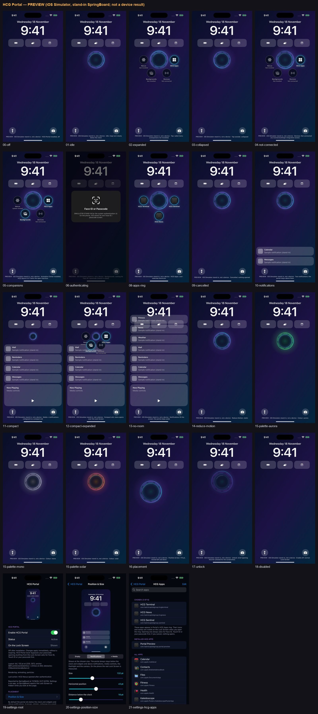

# HCG Portal

**A luminous, interactive portal on the iPhone Lock Screen.** A rootless jailbreak tweak by Hakmi Capital Group.

> **0.1.0~beta1 — free public candidate demo, published in HCG Repo Candidate (`https://repo.hakmicapitalgroup.com/repo/candidate/`). Built and validated with Xcode, tested in the
> iOS Simulator; NOT yet tested on a device.** See [Status](#status) for exactly what was verified and how.

HCG Portal places a portal below the clock and widgets and above notifications: a dark translucent centre, cyan-and-
violet energy rings that turn slowly, a soft glow, sparse particles and a shadow for depth. Tap it and a radial menu
opens; tap outside and it closes. Every destination that opens something asks for **Face ID, Touch ID or your passcode
first** — the normal iOS request — and only the action you chose runs after success. Cancel, and nothing happens.



*Simulator preview with a stand-in Lock Screen (not a device). Video and full-size screenshots: the
`hcg-portal-preview` artifact of the HCG Portal preview workflow.*

## Features (in code)

| | |
|---|---|
| **Portal** | Dark translucent core, conic cyan→violet outer ring, dashed counter-rotating ring, inner arc, glow, ≤ 6 particles/s, depth shadow. Core Animation only |
| **Idle** | Slow rotation (one lap per 24 s at speed 1), breathing core |
| **Tap** | Radial menu: **Nexus · Backgrounds · Devices · HCG Apps**. 64 pt targets; tap outside / 12 s idle / screen off collapses it |
| **Unlock** | Optional 0.5 s opening flourish that never delays unlocking |
| **Destinations** | Backgrounds → Settings (HCG Animation Center). HCG Apps → up to six apps you choose. Devices → *Not connected*. Nexus → *Update needed* until HCG Nexus offers `HCGNexusPortalInterface` (Portal's side is ready). Missing companions → *Not installed* |
| **Authentication** | SpringBoard's own unlock request (`unlockWithRequest:completion:`); the selected action runs once after success; cancel / refusal / screen-off / 90 s timeout discard it. No passcode handling, no bypass |
| **Coexistence** | Measures clock, widgets, notifications, media controls, Live Activities, flashlight and camera; moves, shrinks, collapses to a 56 pt orb or hides. Decorative layers pass touches through |
| **Settings** | Live mini Lock Screen preview; Position & Size (drag, pinch, sliders, sample notifications, **Reset**); colour (HCG Signature, Aurora, Solar, Mono), brightness, speed, intensity; unlock animation; Low Power Mode (Static / Economy / Hide); HCG Apps; status and recovery |
| **Efficiency** | Paused whenever not visible (screen off, unlocked, authenticating, no room). Reduce Motion → static. Low Power → static by default |
| **Safety** | Off after installation. Master switch, kill switch, launch guard, fault fallback. Three hooks that call the original methods first. Disabling or removing restores the normal Lock Screen |
| **Privacy** | No network, account, telemetry or identifiers. Notifications are measured by frame only, never read. Writes only its own preferences |

## Status

> **0.1.0~beta3 (test build, branch `claude/portal-0.1.0-beta3-lifecycle`)**: Lock Screen lifecycle hardening after
> the Safe Mode incident with 0.1.0~beta1 (`CHANGELOG.md`, `docs/INCIDENT_0.1.0-beta1.md`). Cause **not confirmed**
> (no crash report reviewed yet). Kept as a CI test artifact until the short device test passes
> (`docs/DEVICE_TEST_CHECKLIST.md`, P1–P7). Not imported into HCG Repo. If the phone is in Safe Mode, see
> `docs/RECOVERY.md` §0 first.
>
> **0.1.0~beta2 (test build, branch `claude/portal-0.1.0-beta2-startup`)**: startup hardening after a SpringBoard Safe
> Mode incident with 0.1.0~beta1 (see `CHANGELOG.md`). Kept as a CI test artifact until it has been tried on the phone
> from the recording (`docs/DEVICE_TEST_CHECKLIST.md`, rows B0–B8). Not imported into HCG Repo.
>
> Test artifact: `com.hakmicapitalgroup.portal_0.1.0~beta2_iphoneos-arm64.deb`, 275,100 bytes, SHA-256
> `25d7a608ed19023c9ad73798b13326bbf0f3dc85d167f338aeaf73d2a5435bee`, commit `9b5f5a2`, *HCG Portal build* run
> [44663876626](https://github.com/F1r3srp3nt/HCG-Jailbreak-Research/actions/runs/44663876626) (artifact 14597440625).
> `validate.sh --require-new-abi` 0 failures / 0 warnings (also outside CI on the downloaded bytes); no Substrate load
> command in either slice; host tests 2,623,892 checks; Simulator runtime 66/66; preview
> [44663876603](https://github.com/F1r3srp3nt/HCG-Jailbreak-Research/actions/runs/44663876603) 95/95. Simulator only.


**Candidate build:** `com.hakmicapitalgroup.portal_0.1.0~beta1_iphoneos-arm64.deb`, 273,714 bytes, SHA-256
`9ccfeb9b6b832edb3e8745c8e1774d93cc5623ebde1023102cf95bb139220dae` — commit `4bfed33`, *HCG Portal build* run
[44395826216](https://github.com/F1r3srp3nt/HCG-Jailbreak-Research/actions/runs/44395826216), artifact
`hcg-portal-rootless-deb` 14470690859. Other builds of this branch carry the same version but other bytes and are not
candidates.

| Check | Where | Result |
|---|---|---|
| Host unit tests: layout over 200 k random screens, menu geometry, render plan, all 2,048 visibility inputs, 200 k pending-action sequences (ASan/UBSan) | Linux GCC + Clang (*HCG Portal Linux check*), macOS (build run) | **pass**, 2.6 M checks |
| macOS/Xcode build + `validate.sh --require-new-abi` | run 44395826216 | **pass**, 0 failures, 0 warnings, native arm64e ABI (`0x80000002`) |
| Same bytes re-hashed and re-validated from the source commit | outside CI (Linux), and the *HCG Portal handoff archive* run [44398734537](https://github.com/F1r3srp3nt/HCG-Jailbreak-Research/actions/runs/44398734537) | **pass**, same SHA-256 |
| iOS Simulator runtime tests (headless) | run 44395826216, `simulator-tests` | **66/66** |
| Simulator preview: real tweak + Settings code in a stand-in Lock Screen; video + 23 screenshots | *HCG Portal preview* run [44395826055](https://github.com/F1r3srp3nt/HCG-Jailbreak-Research/actions/runs/44395826055) | **81/81** (Simulator only) |
| HCG Repo Candidate | F1r3srp3nt/HCG-repo [PR #11](https://github.com/F1r3srp3nt/HCG-repo/pull/11) (Prepare packages **IMPORTED**, Validate passed), Publish run [44402572548](https://github.com/F1r3srp3nt/HCG-repo/actions/runs/44402572548) | **published** to `https://repo.hakmicapitalgroup.com/repo/candidate/`; online verification 0 errors; stable source unchanged |
| **Device** | — | **not tested** — `docs/DEVICE_TEST_CHECKLIST.md` |

The test phone on record is an iPhone 11 Pro Max on iOS 17.4 with Dopamine (rootless); **not confirmed for Portal**.
See `docs/COMPATIBILITY.md`.

## Layout

```
HCGPortal/
├── control, Makefile, HCGPortal.plist   package metadata, build, injection filter (SpringBoard only)
├── src/                                 tweak: PortalCore.c (pure C decisions) + Objective-C (controller, overlay, view, auth, …)
├── preferences/                         Settings bundle (root pane, Position & Size, HCG Apps, live preview)
├── layout/                              PreferenceLoader entry, postrm (purge-only cleanup)
├── scripts/                             build, validate, preview, simulator tests, icon, Root.plist generator, device info
├── tests/                               host tests (C), Simulator runtime tests (Obj-C), packaging-format tests
├── preview/                             Simulator stand-ins and the preview app (never in the package)
├── docs/                                architecture, compatibility, integrations, roadmap, testing, recovery, checklist
└── distribution/                        HCG Repo candidate kit and handoff
```

## Documentation

- [`docs/ARCHITECTURE.md`](docs/ARCHITECTURE.md): host, layout, touches, rendering, visibility, authentication, safety
- [`docs/INTEGRATIONS.md`](docs/INTEGRATIONS.md): Nexus, Animation Center, Halo, Devices, Agent Runtime — contracts and companion changes
- [`docs/COMPATIBILITY.md`](docs/COMPATIBILITY.md): device facts, iOS range, every SpringBoard interface and its fallback
- [`docs/ROADMAP.md`](docs/ROADMAP.md): typed commands and voice, device selection, Agent Runtime approvals, themes (not implemented)
- [`docs/TESTING.md`](docs/TESTING.md): what each test proves; Simulator vs device
- [`docs/RECOVERY.md`](docs/RECOVERY.md) (incl. Safe Mode), [`docs/INCIDENT_0.1.0-beta1.md`](docs/INCIDENT_0.1.0-beta1.md), [`docs/DEVICE_TEST_CHECKLIST.md`](docs/DEVICE_TEST_CHECKLIST.md), [`docs/BUILD.md`](docs/BUILD.md)
- [`distribution/README.md`](distribution/README.md): HCG Repo candidate kit · [`CHANGELOG.md`](CHANGELOG.md)

## Licence

Proprietary freeware ([`LICENSE`](LICENSE)), the same model as HCG Halo, Vortex and Animation Center. The icon is
**provisional** original artwork (`scripts/make_icon.py`).
