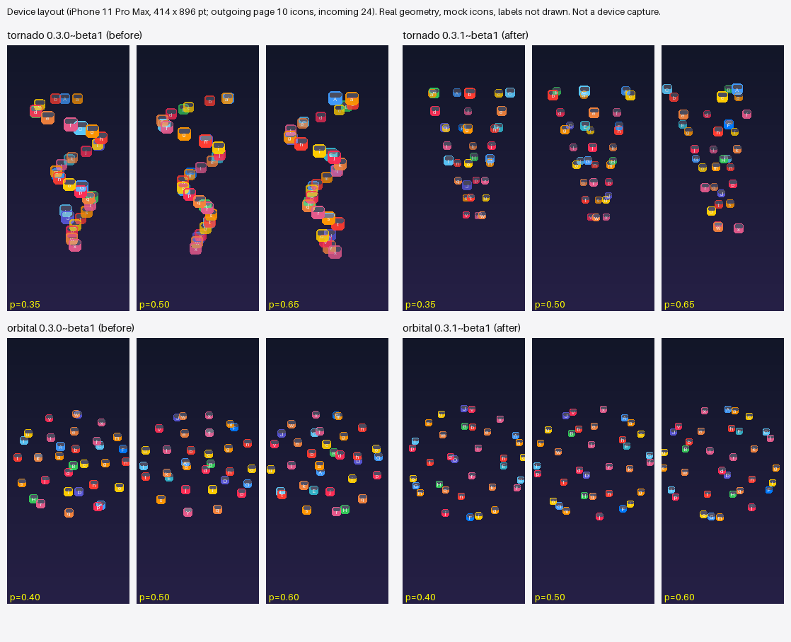
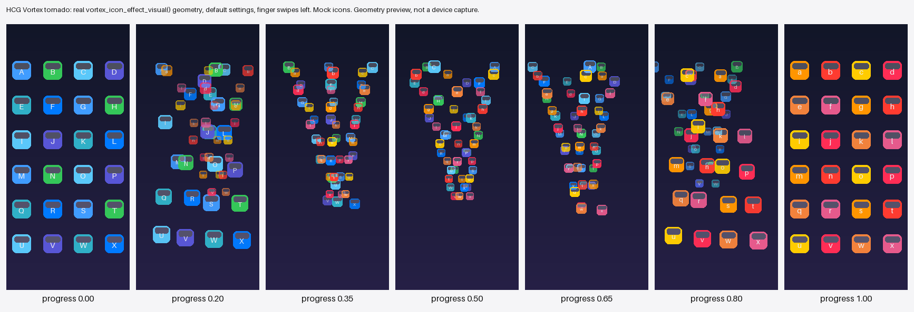
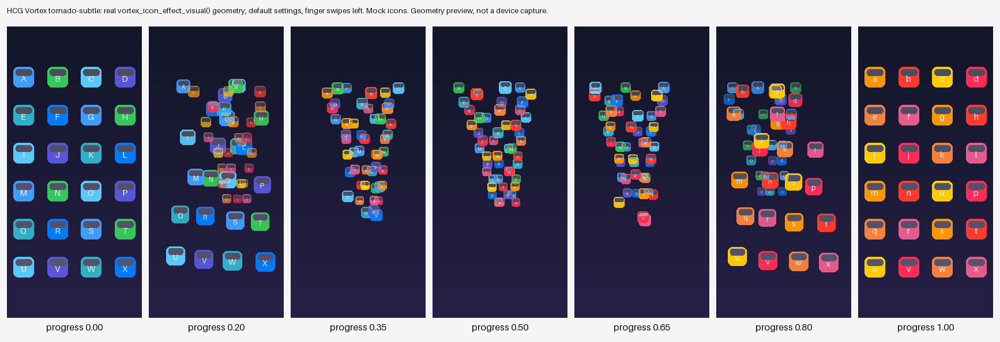
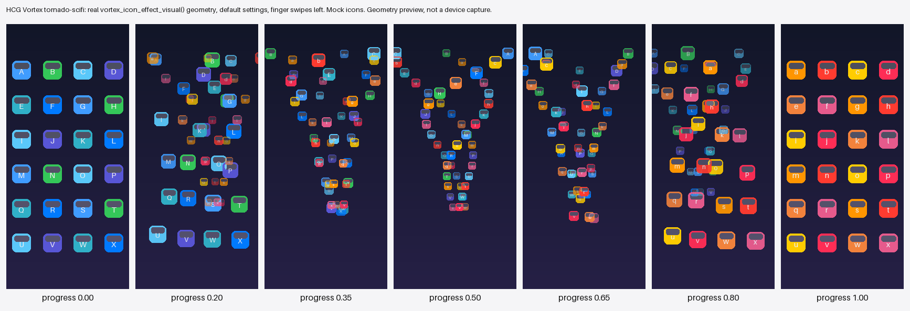
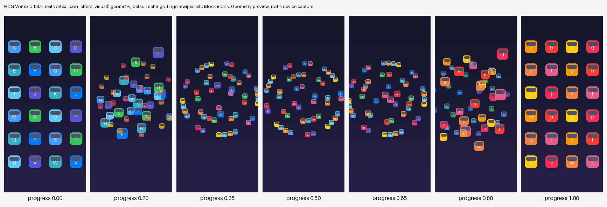
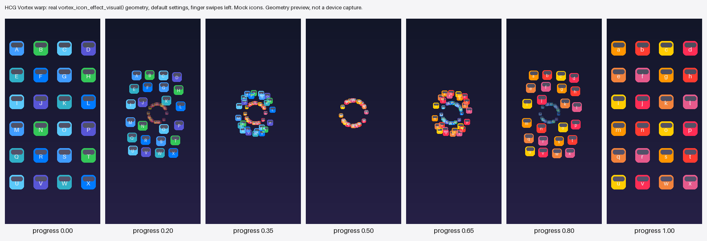
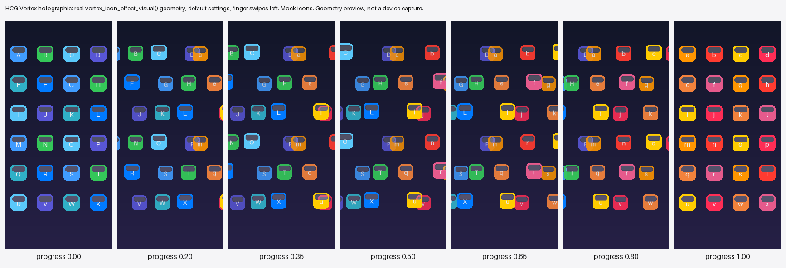
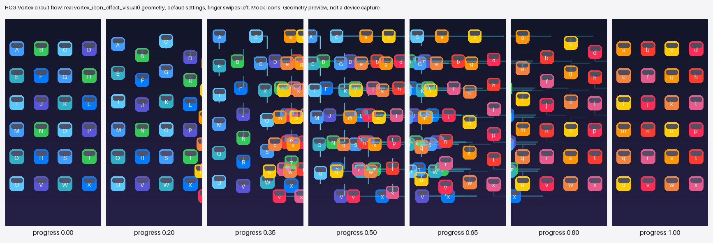
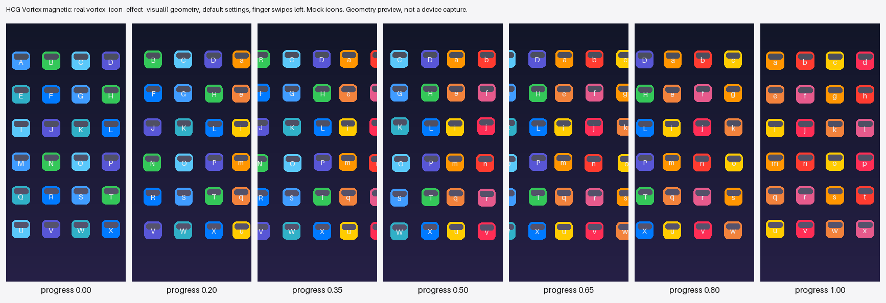

# Effects

| Effect | Identifier | Moves | Since | Status |
|---|---|---|---|---|
| Reverse Slide | `reverse-slide` | pages | 0.1.0 | build-validated |
| Vertical Rise | `vertical-rise` | pages | 0.1.0 | build-validated |
| Vertical Fall | `vertical-fall` | pages | 0.1.0 | build-validated |
| Custom Directions | `custom` | pages | 0.1.0 | build-validated |
| **Tornado** | `tornado` | icons | 0.2.0 (controls 0.3.0) | build-validated, geometry preview |
| **Orbital** | `orbital` | icons | 0.3.0 | build-validated, geometry preview |
| **Warp** | `warp` | icons | 0.3.0 | build-validated, geometry preview |
| **Holographic Layers** | `holographic` | icons | 0.3.0 | build-validated, geometry preview |
| **Circuit Flow** | `circuit-flow` | icons + traces | 0.3.0 | build-validated, geometry preview |
| **Magnetic Grid** | `magnetic` | icons (pages move as iOS) | 0.3.0 | build-validated, geometry preview |
| iOS Default | `stock` | nothing | 0.1.0 | — |

**Device testing so far:** one partial recording (`docs/device-tests/2026-11-18-recording-0.3.0.md`). Orbital,
Tornado and Magnetic Grid were seen running on 0.3.0, and their findings are fixed in 0.3.1. Warp, Holographic Layers
and Circuit Flow have not been run on a device. "Geometry preview" means images drawn from the real geometry functions
with mock icons (`tests/build/effect_frames` → `scripts/render_effect_preview.py`). They are **not** captures of
SpringBoard. Every effect is optional and selectable as the preset or per swipe direction.

## Shared engine

- **One progress model.** Every per-icon effect is a pure C function of the raw gesture progress
  (`src/VortexIconEffects.c`, Tornado in `src/VortexTornado.c`). Each page has its own travel *u*: outgoing
  *u* = progress, incoming *u* = 1 − progress. *u* = 0 is the icon in its grid. There is no animation state, so for
  every effect pausing holds, reversing unwinds and cancelling restores.
- **What the engine touches.** It sets, on each `SBIconView` of the two pages in the transition:
  - `layer.sublayerTransform`: offset, scale, rotation, 3-D tilt;
  - `layer.zPosition`: depth order within the page;
  - `layer.opacity`.

  Circuit Flow also adds one container layer of six `CAShapeLayer`s to each of those pages. Nothing changes frames,
  icon order, the saved layout or hit-testing.
- **Restoration.** Originals are recorded, and every icon is restored (and every trace layer removed) when:
  - the swipe settles or is cancelled;
  - an effect or the tweak is disabled, or the configuration changes;
  - edit mode starts, or the Home Screen leaves the window;
  - Reduce Motion changes;
  - a fault trips the engine.

  Anything not updated in a frame is restored at the end of that frame.
- **Widgets and oversized icon views** (over 30 % of the page width) never join a formation. They fade in place;
  with Magnetic Grid they move with their page.
- **Exclusions are unchanged:** folders, Today View, App Library and edit mode stay stock.
- **Reduce Motion:** all six icon effects use the stock animation while it is on.
- **Kill switch, master switch, launch guard:** unchanged.

## Tornado

The icons lift out of the grid into a 3-D tornado and the funnel travels with the swipe. It has:
- a narrow lower tip and a wider upper opening;
- three interleaved spiral strands per page, with the other page's three between them, so every height has icons
  around it;
- icons that shrink towards the tip, with depth.

The incoming page's icons unwind into their exact grid positions. Labels hide while icons are in the funnel. Both
pages are in the funnel at mid-swipe. In 0.3.1 the funnel was rebuilt after a device recording showed a thin rope;
see the before/after image below.

| Classic Tornado (default) | Subtle | Sci-Fi Vortex |
|---|---|---|
|  |  |  |

**Controls:**
- **Preset:** Subtle / Classic Tornado / Sci-Fi Vortex / Custom.
- **Funnel Height:** 0.35–0.85 of the screen height.
- **Upper Radius:** 0.15–0.6 of the screen width.
- **Lower Radius:** 0.02–0.25, always smaller than the upper radius.
- **Spiral Turns:** 0.5–3 (turns per strand).
- **Intensity:** 0.1–1.
- **Depth & Perspective:** 0–1.
- **Rotation Direction:** Follow Swipe / Clockwise / Counterclockwise.
- **Travel:** Follow Swipe / Against Swipe / Stay Centred.
- **Spin Icons:** off by default, so icon faces stay readable.
- **Reset to Defaults.**

## Orbital

Icons move onto 2–5 concentric rings around a shared centre. Inner rings travel faster. The icons orbit, then resolve
into the next page's grid. The rings are tilted slightly for subtle depth: rings, not a funnel.

Since 0.3.1 the rings use shared slots with fixed capacity: a partial page still occupies every ring, and the two pages
take alternate positions on an interleaved lattice, so they never coincide. Labels hide while icons are in orbit.

**Controls:** Outer Radius, Rings, Ring Tilt, Orbit Speed, Direction, Reset.

## Warp

Icons recede towards a vanishing point onto a tunnel ring (perspective), then expand into the destination grid.
Opacity and scale change monotonically, so nothing flashes, and there is no blur.

**Controls:** Intensity, Perspective, Reset.

## Holographic Layers

Icons separate into 2–4 depth layers that slide at different speeds (parallax). The layers float, tilt in 3-D and
turn slightly translucent at the back. At both ends every icon and label is back to its original appearance (tested:
identity).

**Controls:** Depth, Tilt, Layers, Reset.

## Circuit Flow

Icons run along right-angle traces on bus lanes between the rows. Each leaves a brief illuminated trail of
configurable length, which fades in and out with that icon's run, so nothing is drawn at rest.
- **Rendering:** per page, three brightness buckets × (glow, core) shape-layer paths, rebuilt each frame. There are
  no shadows, blur or images.
- **Colour and glow:** the Accent Colour and Glow Intensity in Appearance.
- **Combinations:** standalone only. It is not combined with other effects; that would need measured performance
  first.

**Controls:** Trail Length, Trace Intensity, Reset. Appearance has Accent Colour and Glow Intensity.

## Magnetic Grid

The subtle everyday option. Pages move exactly as in iOS. Icons loosen gently from the grid (at most about 14 pt),
then lock into their exact positions with a single bounded overshoot (at most about 3 pt) during the last 12 % of the
arrival.
- The motion is driven by progress, so nothing moves after the page has arrived.
- It has no prolonged bouncing: at most one sign change, which is tested.

**Controls:** Separation, Snap, Reset.

## Settings layout

- **Root pane:** Enable, Animation Preset and Restore Default Behavior.
- **Effects:** one page per effect, each with a description, a **live preview** (`VortexEffectPreviewCell`, running
  the same C geometry with your settings), its controls and Reset to Defaults.
- **Directional Controls:** the page effects.
- **Appearance:** accent colour and glow.
- **Accessibility & Performance:** Reduce Motion status and behaviour, the performance caveat, and the safety switches.
- **Timing:** duration, speed, intensity and easing.
- **Reset & Diagnostics.**

## Verified so far

- **Host tests:**
  - `tests/test_math.c` (2,227,615 checks);
  - `tests/test_tornado.c` (13,080,798);
  - `tests/test_icon_effects.c` (15,720,198).

  They cover:
  - the start and end contract of every effect, for both roles, 1–24 icons, minimum, default and maximum settings
    and both swipe directions;
  - continuity, by halving the frame step;
  - pause, reverse and cancel through the real navigation state machine;
  - each effect's shape: ring count, tunnel compression, layer bands with parallax, axis-aligned traces attached to
    their icons, and a bounded snap;
  - Tornado presets and travel modes;
  - degenerate input.
- **Validation:**
  - `validate.sh` checks every Settings pane against the code and runs all three test binaries;
  - the package is checked for gzip format, Mach-O and arm64e ABI, injection filter and forbidden APIs.

## Not yet verified (needs a device)

- That `SBIconView`s are direct subviews of `SBIconListView` on the tested iOS. If they are not, icon effects degrade
  to the page visual only.
- Frame rate, smoothness and battery impact on real hardware, including Circuit Flow's per-frame paths.
- Icon taps opening the intended app after a completed and after a cancelled swipe.
- Widgets, partially filled pages, Today View, App Library and folders on a device.
- Coexistence with HCG Halo or HCG Nexus. **Not tested; no compatibility is claimed.**
